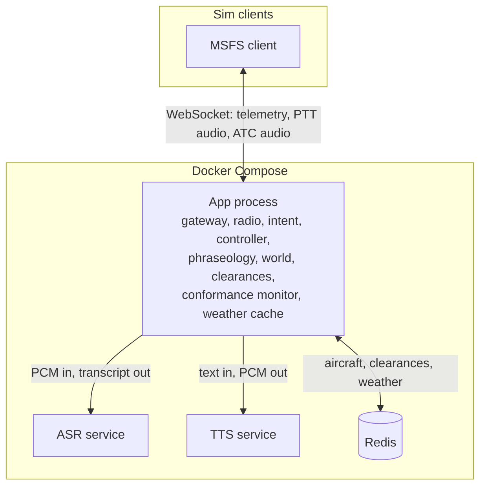
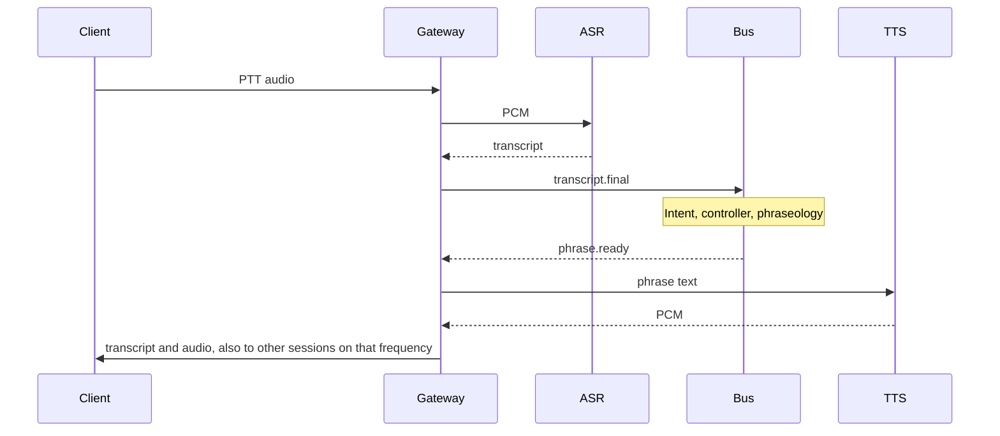

# AI ATC architecture

The client (`client/`) stays thin: SimConnect, microphone, speaker, and a WebSocket. All judgment lives on the server. Speech recognition and speech synthesis are separate processes. Everything that decides what a pilot is told is one process for now, split into modules that talk through an in-process event bus and Redis. Those modules are the seams we split into their own services later, without changing the events.

This is for the simulator only.

## What runs today



| Piece | Process | Owns |
| --- | --- | --- |
| Gateway | App | WebSocket sessions, auth, the client wire protocol |
| Radio | App | Which session is tuned to which frequency, and who hears a transmission |
| Intent | App | Transcript to a typed intent. Rules only. No model output is executed |
| Controller | App | Clearances and corrective calls. Deterministic |
| Phraseology | App | Typed instruction to the words that are spoken |
| World | App, state in Redis | Latest position, phase, frequency, callsign per session |
| Clearances | App, state in Redis | Active constraints per session |
| Conformance monitor | App | Compares telemetry with clearances and emits deviations |
| Weather cache | App, state in Redis | Latest METAR text per ICAO. Ingest is off unless configured |
| ASR | Own container | `stub`, `openai`, or `whisper_atc` |
| TTS | Own container | `stub`, `openai`, or `kokoro` |

Audio does not go on the bus. The gateway streams push-to-talk audio to ASR over HTTP, and TTS audio back to the client. The bus carries facts and decisions only.

## Folders

```text
server/
  docker-compose.yml          redis, asr, tts, app
  Dockerfile                  the app process
  src/atc_server/
    gateway/                  protocol, session, radio effect, phrase delivery
    voice/                    HTTP clients for ASR and TTS
    intent/
    controller/
    phraseology/
    world/
    clearances/
    monitor/
    radio/
    weather/
    bus.py                    in-process pub/sub
    contracts.py              events shared by the modules
  services/asr/               separate speech-recognition service
  services/tts/               separate speech-synthesis service
```

## Bus

Handlers run inline on the asyncio loop. A publish finishes only after every subscriber has finished, including the subscribers those handlers publish to. That keeps one pilot's exchange ordered. It also means a handler must not wait on the WebSocket read loop.

| Topic | Payload | Publishers | Subscribers |
| --- | --- | --- | --- |
| `transcript.final` | Pilot text for one exchange | Gateway | Intent |
| `intent.parsed` | Typed intent | Intent | Controller |
| `instruction.issued` | What to do, not how to say it | Controller | Phraseology |
| `phrase.ready` | Words to speak, plus who and which frequency | Phraseology, or the gateway in echo mode | Gateway hub |
| `telemetry.updated` | Aircraft snapshot | Gateway | Conformance monitor |
| `deviation.detected` | Constraint broken for long enough | Monitor | Controller |

Redis keys, all with a six-hour TTL refreshed on write:

- `atc:aircraft:{session_id}`
- `atc:clearance:{session_id}`
- `atc:weather:{icao}`

`session_id` is the aircraft id until a pilot can reconnect and keep the same clearance.

## Pilot speaks



The controller writes the clearance to Redis before the phrase is spoken. A clearance is not a sentence. Phraseology is the only place that turns it into words.

Intent kinds the controller acts on today:

- `altitude_request` with an altitude in feet. Stored as an altitude clearance. The call is climb, descend, or maintain, based on the aircraft's current altitude.
- `taxi_request`. The reply is hold position. Taxi routes need airport geometry we do not have yet.
- anything else. The reply is "say again". The controller does not invent a clearance from free text.

## Deviation

The monitor handles this. The language model is not on this path.

An altitude clearance is checked only while the aircraft is airborne. On the ground the breach timer resets, so a departure clearance does not nag a parked aircraft. Once airborne, if the altitude stays outside the tolerance for the configured sustain time, the monitor emits one deviation. The controller then issues one corrective call ("check your altitude"). The latch clears when the aircraft is back inside tolerance or on the ground, so a later excursion can be called again.

Defaults are 200 ft and 5 seconds (`ATC_ALTITUDE_TOLERANCE_FT`, `ATC_DEVIATION_SUSTAIN_S`). The Compose file used for the integration test sets sustain to 0 so the check fires on the first bad sample.

## Weather

The cache is real. The ingest loop starts only when `ATC_WEATHER_INGEST=true`, `ATC_WEATHER_METAR_URL` is set, and `ATC_WEATHER_ICAOS` lists stations. The URL is operator-configured, so the loop does not run in Compose and the code does not hard-code a host. The intended source is the aviationweather.gov METAR feed documented in [`external-data.md`](./external-data.md).

## ASR and TTS

Both are small FastAPI services.

- `POST /v1/transcribe` on ASR. Body is PCM16 mono. Query: `sample_rate`, optional `hint`. Response: `{"text": "..."}`.
- `POST /v1/synthesize` on TTS. JSON `{"text": "..."}`. Response body is PCM16 mono. Header `X-Sample-Rate`.

`ASR_PROVIDER` and `TTS_PROVIDER` are `stub` in Compose, so the stack runs without GPU, model weights, or API keys. `openai` uses `OPENAI_API_KEY` in that service's environment. `whisper_atc` and `kokoro` stay in those services and are not installed in the default images. They need the extra packages from each service README section in `server/README.md`.

`ATC_REPLY_MODE=echo` skips intent and the controller and speaks the transcript back. It is a voice-path check, not an ATC mode.

## What is deliberately not running yet

These were in the design and are not separate programs yet. Adding them should follow the same rule: a new module behind the bus or Redis, then its own process only when it needs to scale apart from the app.

| Later service | Why it is not here |
| --- | --- |
| NATS (or similar) | The in-process bus is the monolith transport. Replace `bus.py` when a module moves to another process |
| Postgres | Accounts, navdata, and the audit log. Redis is the hot state |
| Sequencing and separation | Needs more than one aircraft and a runway model before it can make honest decisions |
| Nav and airport data | Runways, taxiways, procedures. Do not invent them. Prefer the sim's facility data or a licensed source |
| ATIS and runway config | Needs weather plus runway geometry |
| VATSIM / IVAO bridge | A human controller on a frequency must silence the AI facility. No feed is wired in |
| Event archive | Replay and evals. The bus is not a log |

## Scale-out

When one app process is not enough:

1. Move ASR and TTS first. That is already done. Add replicas behind the URLs the gateway already calls.
2. Move the conformance monitor next. It only needs the telemetry stream and the clearance keys.
3. Shard the controller by facility (tower, approach, center sector). A handoff is an event that changes which facility owns the aircraft.
4. Replace the in-process bus with NATS JetStream using the same topics. Keep Postgres for navdata and the audit trail, not for the position updates.

Binding: inside Compose the processes listen on all interfaces so the Docker network can reach them. Do not publish ASR, TTS, or Redis onto a public host. The client-facing port is the app. Set `ATC_AUTH_TOKEN` outside local dev.

## Assumptions

- Altitude conformance is our policy (airborne only, tolerance, sustain). It is not a sim rule.
- Transmit frequency is COM1 unless only COM2 is the transmit radio.
- `session_id` is the aircraft key until reconnects are designed.
- Weather ingest stays off until an operator sets `ATC_WEATHER_METAR_URL`. The public aviationweather.gov path is in [`external-data.md`](./external-data.md).
- Sim behavior of the client telemetry fields is not verified from this environment. The wire fields match `client/MsfsAtc.Client/Protocol/Messages.cs`.
